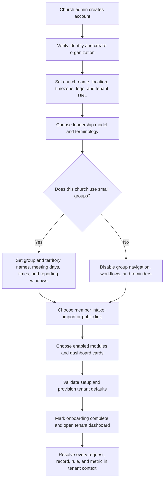
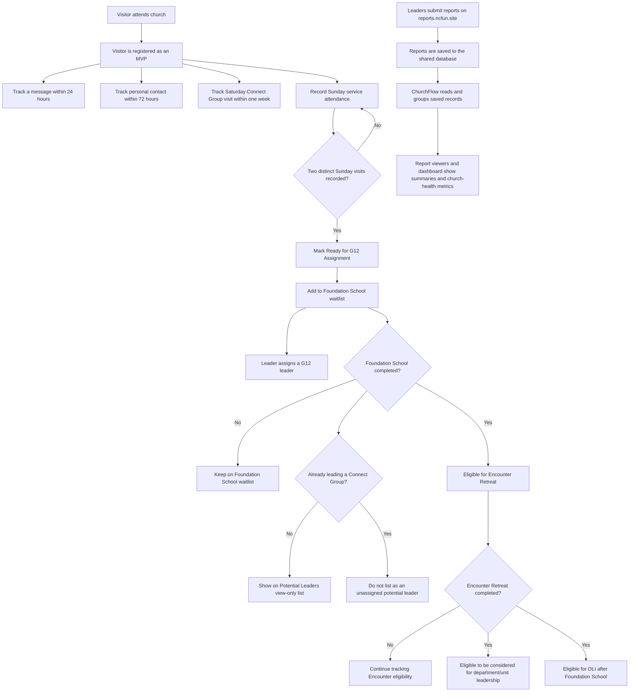
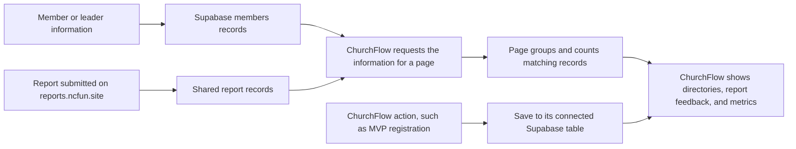
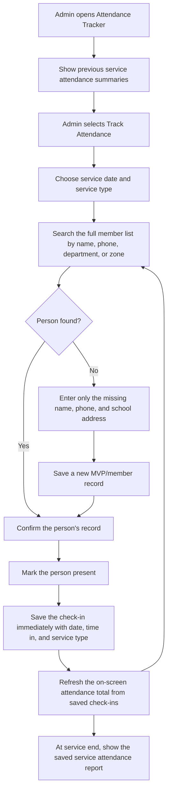
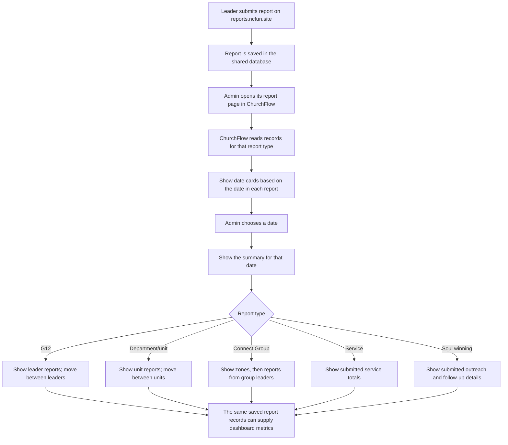
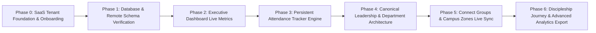

# ChurchFlow: Unified Church Membership and Discipleship Flow

ChurchFlow is a church membership and discipleship SaaS that helps leaders understand how their church is doing. It brings membership, attendance, reports, Connect Groups, G12, departments, outreach, and discipleship into one place so leaders can see reliable church-health measures and know where follow-up is needed.

This guide describes the intended workflow in plain language. It also identifies what the current app already does and what still needs to be connected. A number is a **live metric** only when it comes from saved, current records—not when it is typed into the page as an example.

## 0. SaaS setup comes before church operations

Tenant setup is the first part of ChurchFlow's algorithm, not a settings task to bolt on after the dashboard. No member, report, schedule, navigation item, or metric should be created or interpreted until ChurchFlow knows which organization owns the data and which rules that organization follows.

### Onboarding decisions and their effects

1. **Account and organization:** Authenticate the admin, create the organization, and grant its creator the organization-owner role. The organization is the tenant boundary. Create the organization and its initial owner membership through a trusted, atomic server-side operation; do not rely on browser-side inserts to establish authorization.
2. **Identity and branding:** Save the church name, campus/location, IANA timezone, logo, and unique tenant slug. Validate slug conflicts and timezone values. Tenant-local dates, schedules, reminders, and birthday notices use this timezone, not the browser's timezone.
3. **Leadership topology:** Support G12/cell hierarchy, traditional pastoral/board hierarchy, and custom or flat structures. Store the model and editable terminology aliases (for example, leader, group, territory, and department labels). A model selects which concepts are available; it must not create fake leaders or assignments.
4. **Groups and cadence:** Ask whether the tenant uses small groups. When enabled, configure the group's singular/plural names, territory label, meeting day(s), time, and reporting window. When disabled, hide group navigation and workflows and suppress group reminders and metrics; retain existing records if the module is later disabled. Meeting cadence must be tenant data, not a hard-coded global rule.
5. **Member intake:** Allow a validated CSV import with preview and duplicate handling, an invitation/intake link, or both. Public intake links must be unguessable, scoped to one tenant, revocable/rotatable, and validated server-side; the link itself is not authorization to read or modify existing member records. Imports must not leave partial member records on failure.
6. **Modules and dashboard:** Let an admin enable the modules and cards the church needs (for example, service attendance, birthdays, discipleship, first-timer follow-up, groups, and optional giving). Validate dependencies before saving. A disabled module is unavailable in navigation, routes, APIs, reminders, and metrics—not merely hidden in the sidebar.
7. **Provision and enter the dashboard:** Save the tenant configuration, owner role, and required defaults; verify required setup; then mark onboarding complete. Provisioning must be safe to retry and must not duplicate seed records. If a step fails, report the error and let the admin resume rather than showing a completed dashboard for a partially configured tenant.

### Tenant boundary and runtime algorithm

- Use one shared application schema with an authoritative tenant/organization ID on every tenant-owned record, including members, leaders, groups, reports, attendance, and settings. Do not create a separate physical database schema for every church just to change vocabulary. Keep configuration in typed, validated organization fields and/or a versioned tenant-settings record.
- Resolve the signed-in user's organization membership and role on the server. Enforce tenant isolation in Postgres RLS and trusted write operations; client filters are not a security boundary. A user belonging to multiple organizations must select an active organization, and every read/write must be scoped to it.
- At startup, load the active tenant's configuration and use it as the source of truth for terminology, enabled modules, branding, timezone, hierarchy, and schedules. Sidebar visibility, route guards, data services, report expectations, and dashboard calculations must all use the same configuration.
- For each metric or workflow, first check that its module is enabled, then apply that tenant's structure and schedule to that tenant's saved records. If a required configuration or source record is missing, show it as unavailable; do not silently fall back to NCF UNN values or sample data.
- Configuration changes must take effect consistently across pages and be auditable. Disabling a feature must not delete its data. Re-enabling it restores access to retained records subject to permissions.

The existing NCF UNN workflows below are the flagship tenant's baseline, not universal SaaS defaults. Their G12, Connect Group, Sunday/midweek, Saturday, follow-up windows, stage thresholds, and numerical targets must be represented as NCF UNN configuration. Another tenant's selected model, labels, enabled modules, and saved cadence take precedence. This tenant model and configuration provider are also prerequisites for the `useTenantConfig()` and tenant/RLS architecture in the [ChurchFlow SaaS master plan](../CHURCHFLOW_SAAS_MASTER_PLAN.md).

## 1. The church journey after tenant onboarding

This is the NCF UNN baseline journey after tenant onboarding is complete. Resolve its labels, stages, schedules, and enabled branches from the active tenant configuration: skip G12 stages for a tenant without G12, skip group steps when small groups are disabled, and use configured meeting dates rather than assuming Saturday or Sunday. The 24/72-hour follow-up windows and two-visit threshold shown here are NCF UNN rules; other tenants must configure their own thresholds or leave them undefined rather than inherit them silently.

This flow has two connected parts:

1. **People pathway:** visitor → MVP follow-up → Sunday attendance → G12 and Foundation School → Encounter → leadership consideration and DLI.
2. **Church reporting:** leaders submit reports on **reports.ncfun.site** → the shared database stores them → ChurchFlow displays the reports and uses the saved information for metrics.

ChurchFlow should not invent missing facts. If a date, assignment, completion, or report is not recorded, show it as missing or unavailable instead of filling in an estimate.

## 2. How information moves through ChurchFlow

ChurchFlow is the screen leaders use. Supabase is the shared online database that holds the saved records.

The main records currently referenced by ChurchFlow are:

| Record group | What it is for |
| --- | --- |
| `members` | Main member list, including member name and available details such as phone, department, zone, G12 leader, membership level, and join date. |
| `mvps` | First-time visitor/MVP registration details. |
| `g12_reports` | G12 attendance submitted for individual members. |
| `department_reports` | Department/unit worker attendance submitted for individual workers. |
| `cell_reports` | Connect Group meeting information and totals. The current ChurchFlow type describes leader, location, meeting times, attendance, new converts, offering, refreshments, notes, and report date. |
| Service report records | Service attendance, MVP/second-timer numbers, souls won, offering, tithe, and related details, when supplied by the external report system. The exact table and saved column names must be confirmed against that system. |
| Soul-winning report records | Outreach and follow-up information, when supplied by the external report system. The exact table and saved column names must be confirmed before calculating totals. |
| Discipleship progress records | Sunday visits, G12 assignment, Foundation School, Encounter Retreat, DLI, and Connect Group leadership. The current ChurchFlow pages do not yet provide a confirmed saved record for this full pathway. |
| Connect Group directory and assignments | The real list of groups, their zones and leaders, and member assignments. These records are needed for trustworthy group totals and potential-leader checks; the current page uses examples instead. |

The external report site and ChurchFlow must use the same saved report information, or a reliable connection to it. ChurchFlow's report pages are **view-only**: submissions happen on reports.ncfun.site. The main Attendance Tracker is a separate service check-in workflow; it must save a check-in if it is to contribute to attendance history or a metric.

## 3. Membership dashboard and church-health metrics

When a leader opens the dashboard, ChurchFlow reads the member and report records needed for the selected metrics, calculates the totals, and displays the results. The dashboard is the church-wide overview; organizational pages provide the detail for departments, Connect Groups, and G12.

### Main KPI cards

| Dashboard measure | Information it should use |
| --- | --- |
| Registered members | Count of member records, with membership status clearly defined so inactive/alumni people are not silently confused with active members. |
| Active workers | Count of distinct members assigned to a department/unit, using the member roster rather than an attendance report alone. |
| Active Connect Groups | When groups are enabled, count groups whose reports meet the active-group rule in section 7, measured against the tenant's configured meeting cadence. |
| MVPs / first-time visitors | Track monthly MVPs from the mvp column in service reports. |
| Souls won | Count from confirmed saved soul-winning/service report records for the selected date range. Do not use Connect Group new-convert totals as a substitute unless the metric is explicitly defined that way. |
| Service attendance | Use saved service attendance records for the selected dates and service types. |
| Retention and follow-up | Use recorded MVP follow-up milestones and later attendance. Show the number who reach each step, not an invented retention percentage. |

Each time-based card must say which date range it covers. For example, “This week” must be calculated from this week's saved report dates, not from every row in the table.

### Dashboard charts and other displays

- Attendance trend: show total attendance from saved service reports over time. Provide 1 month, 3 months, 6 months, and 1 year filters, with optional filters for service type and zone where the source data supports them.
- Growth journey: count people at each saved membership/disciple stage; do not use sample counts.
- Department/unit health: calculate attendance from submitted unit reports and the assigned worker roster. Make clear whether the percentage is of people assigned or people included in submitted reports.
- Follow-up queue: show new MVPs due for follow-up and members whose saved attendance is declining. The rule for “declining” must be set from actual attendance history and shown consistently.
- Birthday notices: use member birthdays and the church's local date.
- Missing reports: compare expected reports with received reports. Only call a report missing after its scheduled reporting period has ended.
- Do not present the sample attendance chart, sample heatmap, hand-written ticker examples, or sample follow-up counts as live church metrics.

## 4. Service Attendance Tracker

The Attendance Tracker is where a desk admin records individual attendance at a service. It is not the same as the G12, department, or Connect Group feedback viewers.

### Intended check-in flow

The member search must cover the full database; it must not stop at the first 100 names. The desk admin/usher simply searches by name or phone and taps check-in—no unnecessary questions asked. Zone and department are auto-inherited from the member's record, and the exact **time in** is recorded automatically. If the member is not found, the admin enters only the minimum details (name, phone, school address) to register them as an MVP, saving and checking them in immediately.

Each saved check-in records the member, service date, service type, and exact time in. The same check-in must not be counted twice for one person at one service (enforced by the unique constraint). At the end of the service, the report is a summary of the check-ins already saved; it should not require the admin to submit the same attendance a second time.

## 5. Report pages: read submitted feedback

All G12, department/unit, Connect Group, service, and soul-winning reports are submitted through **reports.ncfun.site**. The corresponding ChurchFlow report pages are for **viewing the submitted feedback**, not entering or submitting it again.

### Shared report-viewing flow

The report date and report type come from the submitted record. ChurchFlow must not move a report to a different date because of when it was viewed. The date cards and expected reports must use the active tenant's configured meeting schedule. Wednesday/Sunday service, G12, and department/unit reports and Saturday Connect Group reports are the NCF UNN baseline only.

At the top of a selected report date, show the figures available from that report:

- **Present:** count of submitted person-by-person entries marked present.
- **Absent:** count of submitted person-by-person entries marked absent.
- **Total reported:** present plus absent when the report contains individual records; otherwise show the total attendance submitted in the meeting summary.
- **Total membership:** number assigned to the group/unit in the member records. Show separately from attendance, because unreported people must not disappear from the membership count.
- **Report coverage:** reports received compared with reports expected, if the expected leader/unit/group list is known. If it is unknown, show “reports received” and do not claim complete coverage.

### G12 report

After the admin selects a service date, show the overall G12 summary, including present, absent, total reported, total G12 membership, and report coverage where those figures are available. Then show a leader's name and the submitted attendance rows for that leader's members. Each row shows the member name, present/absent status, and absence reason if supplied. Use **Previous** and **Next** controls or a slide gesture to move between leaders while keeping the selected date visible.

### Department/unit report

After the admin selects a date on which the tenant schedules a department/unit report, show its summary. Then show one unit at a time with the submitted worker names, attendance status, and absence reasons where provided. Use **Previous** and **Next** controls or a slide gesture to move between units. The department directory page links here; it does not repeat this report. Wednesday and Sunday are the NCF UNN baseline.

### Connect Group report

Use this order: **configured meeting date → configured territory → group leader's report**. After the admin chooses a date, show the territories with submissions. Selecting a territory such as Odim, Eho, or Franco shows its group reports. Move between group leaders' reports within the chosen territory. Saturday and the example territory names are NCF UNN-specific.

The current report shape contains meeting-level details such as leader, location, times, total attendance, new converts, offering, refreshments, and notes. It may not include individual attendee names and statuses. Only display individual attendance if reports.ncfun.site actually saves those details.

### Service and soul-winning reports

Service reports should show saved information such as male/female/total attendance, MVPs, second-timers, souls won, offering, and tithe, but only for fields actually present in the submitted records.

Soul-winning reports should show submitted outreach records, dates, zones/campaigns, and follow-up details where available. Confirm the external source table and its fields before calculating or labelling a soul-winning metric.

### Missing report checks

Expected submissions are derived from each tenant's enabled modules, configured meeting days, reporting windows, and responsible leaders/units. For NCF UNN, the current baseline is:

- Wednesday and Sunday: service, G12, and department/unit reports.
- Saturday: Connect Group reports.

For each expected report, ChurchFlow needs the date, report type, responsible leader or unit, and (where relevant) territory. Mark a report missing only after that tenant's configured reporting window ends and no matching report is saved. The current NCF UNN windows are 7:00–9:00 PM for Wednesday/Sunday reports and 7:00–10:00 PM for Saturday Connect Group reports. A meeting not on the tenant's expected schedule should not be labelled missing.

## 6. Departments and Units: organizational view

This page is the church's organizational directory of departments and units. Keep the department/unit grid as the main view, with general KPI cards above it. Each card shows the unit name, leader, total people assigned, and new additions for the selected period. Selecting a card opens that unit's detail view with its own KPI cards, leader and assistant details, member roster, and organizational details.

Page-level KPI cards:

- **Total workers:** distinct members assigned to a department/unit.
- **New additions:** distinct people newly added to a unit during the selected date range.

Each unit card can also show that unit's total assigned people and additions. Use saved member assignments and a reliable join/assignment date. If the date needed to calculate additions is not saved, show the number as unavailable instead of guessing.

Provide a hamburger button in the department and unit views. Its menu includes **Job Description** and **View Reports**. **Job Description** opens the relevant description for the department or selected unit. **View Reports** opens the department report page (currently `/reports/department`), which owns service-date selection, attendance summaries, and worker-by-worker feedback.

**Flow:** Open Departments → see general KPI cards → browse unit cards → select a unit → see its KPI cards, leader and assistant details, and member roster → use the hamburger menu to open the job description or **View Reports** for submitted attendance feedback.

## 7. Connect Groups: organizational view

This page is the organizational view of Connect Groups, not a second attendance-report page. Keep the zone grid, then let admins open a zone and browse its actual Connect Groups. Selecting a group shows its leader, assigned members, and group size.

The NCF UNN planning target is **50 Connect Groups**, with a target size of **10–15 members per group**. These are tenant-specific targets, not SaaS defaults. Do not hide groups outside a tenant's configured target; show their size clearly so leaders can decide what action is needed.

Page KPI cards:

- **Total Connect Groups:** count of groups in the saved group directory, shown against the target of 50.
- **Active Connect Groups:** groups with a saved report for at least one of the two most recent scheduled group meetings.
- **Inactive Connect Groups:** groups with no saved report for two consecutive scheduled group meetings. Count missed scheduled meetings, not a fixed number of calendar days.
- **New additions:** distinct people newly added or assigned to a zone during the selected date range.
- **Potential Leaders:** people who completed Foundation School and are not currently leading a Connect Group. Clicking this card opens a **view-only list of names**; it does not appoint or assign them.

If a group has missed one scheduled report but not two, it is not yet inactive; it may be flagged for attention. Use actual submitted report dates and the tenant's schedule to determine activity.

These live measures require a saved group directory, territory and leader assignments, member-to-group assignments, Foundation School completion records, and dated reports. The current page's zones and generated groups are examples, not a reliable saved group directory.

Add a hamburger button to the header bar with **View Reports** and **Cell Outlines**. **View Reports** opens the Connect Group report page (currently `/reports/cell`) described in section 5. **Cell Outlines** opens the separate outline/resource archive, not reports.

**Flow:** When the module is enabled, open the tenant-configured group page → see the available total/active/inactive/additions/potential-leader KPI cards → browse territories → open a territory to see its groups and scoped KPIs → select a group to view its leader, assistant, members, and configured size target → click **Potential Leaders** to see eligible names → use the header menu to open **View Reports** for submitted reports or the configured resource archive.

## 8. G12 and Directorate Management: organizational view

This page shows leadership structures and member assignments; it is not the G12 attendance report page. Show KPI cards, then separate sections for **Directorate Heads (DHs)**, **Core Leaders**, and **G12 Leaders**. Keep the DH and Core sections distinct. Classify all pastors, DHs, and Core leaders as G12 leaders; the G12 section should reflect that classification while avoiding duplicate or conflicting underlying people and assignments. Selecting a leader opens the members assigned to that leader.

Page KPI cards:

- **Total G12 leaders:** count of leaders identified from saved leadership/assignment records.
- **Total Directorate Heads:** count of saved DHs, which are a subset of G12 leaders.
- **Total G12 members:** count of members assigned to a G12 leader.
- **New additions:** members newly assigned to a G12 leader during the selected date range.

Per-leader cards may show the leader's name, assigned-member count, and new additions. Use saved leader and assignment data. Identify pastors, DHs, and Core leaders as G12 leaders, while keeping DH and Core in their own separate sections. Keep recorded roles (pastor, G12 leader, Directorate head, Core leader, worker, unit leader) separate from attendance-based member classifications; do not infer one from the other.

Add a hamburger button beside the heading/action bar with **View Reports** and **Directorate Offices**. **View Reports** opens the G12 report page (currently `/reports/g12`) described in section 5. The directory shows structure and membership; the report page shows attendance feedback. **Directorate Offices** opens an office directory showing the core church systems, who oversees each system, an office description, and the units under that directorate. Use saved office, overseer, and unit assignments; do not infer the directorate structure from labels alone.

**Flow:** Open G12 and DH Management → see KPI cards and separate DH, Core, and G12 leader sections → select a leader → view assigned members → use the hamburger menu to open **View Reports** for submitted attendance or **Directorate Offices** to view core systems, their overseers, descriptions, and units under each directorate.

## 9. Foundation School: cohorts, attendance, and curriculum

Foundation School data must come from saved cohort, student, enrollment, class, teacher, curriculum, attendance, and completion records. Do not use sample data, manually entered totals, or Sunday service attendance as Foundation School data. Protect student records with role-based access and keep an audit trail for enrollment, attendance, completion, and any corrections.

### Cohorts and enrollment

- Show the current cohort, roster, assigned teachers, classes, schedule, and saved attendance summary. Previous cohorts remain available as historical records; starting a new batch must not move students, attendance, or completion records from earlier cohorts.
- Populate the waitlist from the member database with people who are not enrolled in the selected school. Include school filters for **Foundation School**, **Encounter**, and **DLI**. For Foundation School, authorized users may enroll selected waitlist members into a cohort. Waitlisted people remain unenrolled and are excluded from cohort attendance and completion totals until their enrollment is saved. Save enrollment date and status, and prevent duplicate active enrollment in the same school.
- Completion is tracked from saved course/cohort records only. Do not infer completion from waitlist status, partial attendance, or a curriculum listing. Use the saved completion record for downstream eligibility rules in sections 1 and 7.

### Cohort attendance tracker

- The admin selects a cohort, class/session, and session date, then records each enrolled student's status as present or absent. Save each entry against the student, cohort, class/session, and date so it remains available after refresh or later changes.
- For each class/session in a cohort, the admin selects the cohort, class/session, and session date, then records each enrolled student's status as present or absent and their time in. Save each entry against the student, cohort, class/session, and date so it remains available after refresh or later changes.
- Prevent duplicate entries for the same student and session. Allow only authorized corrections to saved entries, and keep a record of the correction reason and timestamp.
- Show present, absent, and not-yet-recorded counts separately. An unmarked student is not absent. Attendance summaries and student histories must use saved session entries only and must not change church service attendance.

### Curriculum and classes

- Show the curriculum for Foundation School courses and their lessons/topics. Link each class/session to its course, cohort, assigned teacher, and scheduled time when those details exist in saved records.
- A curriculum listing does not establish student progress or completion. That requires saved student progress/completion records.

### Foundation School reports

- The reporting site does not yet have a Foundation School submission form. Until the form and its saved report records exist, show report data as unavailable; do not create placeholder records or imply that ChurchFlow attendance entries are external submissions.
- If the external form is later added to reports.ncfun.site, leaders may submit the report there and ChurchFlow provides a view-only report page following section 5. The report must identify its date and cohort/class session and show: **Course | Teacher | Time in–Time out | Attendance**. Use saved submitted records only, and confirm the external table and column names before connecting a viewer or using the data in metrics. Attendance in a report must remain distinct from cohort enrollment and from church service attendance.

### Foundation School SOPs and regulations

- Add a dedicated **SOPs and Regulations** page within Foundation School. This is the operational reference for running the school, separate from cohort management, attendance tracking, curriculum, and reports. It is available only to authorized admins and teachers.
- Treat this content as a framework for the church's approved policies, not a substitute for them. Clearly label drafts as drafts; do not present examples or drafts as active regulations.
- Keep these SOPs distinct from external Foundation School report submissions and from the live enrollment/attendance workflow.
- Organize the page into:
  - **Roles and accountability:** specify who may approve cohorts and enrollments, assign teachers, schedule sessions, record or correct attendance, and verify completion. Enforce role-based permissions.
  - **Cohort setup and enrollment:** confirm the cohort, course, schedule, capacity, eligibility, and staff before enrollment opens. Record enrollment date and status. Keep waitlisted people separate until an authorized user enrolls them.
  - **Class and attendance procedure:** verify cohort, class/session, and date before recording attendance. Mark present or absent for each enrolled student; an unmarked entry remains not recorded. Prevent duplicate entries. Require corrections to include a reason and audit record.
  - **Conduct and participation:** show only the school's approved expectations for punctuality, respectful conduct, participation, absences, and make-up sessions. Do not invent sanctions or eligibility requirements.
  - **Assessment and completion:** document approved assessment and completion criteria, the responsible approver, and how results are saved. Attendance alone does not establish completion; completion requires saved student progress/completion records.
  - **Safeguarding and privacy:** limit student records to authorized roles, document the approved concern process, and preserve audit history for enrollment, attendance corrections, and completion changes. Do not expose sensitive student information on general-facing pages.
  - **Changes and exceptions:** identify who approves schedule changes, withdrawals, transfers, exceptions, and policy revisions, and what record is required. Preserve the decision and effective date.

## 10. Soul Winning and MVP retention

Coming soon. We'll get back to this page.

## 11. About Us

In the primary navigation, keep the existing navigation buttons together and place **About Us** immediately above **Settings**. Put **Settings** at the bottom of the navigation, visually separated from the other navigation buttons. The **About Us** button opens an About Us page containing the Dominion City experience chart, the ministry's twelve graces/anointings, and its core values. Present these as church information, not as member journey stages or calculated metrics.

## 12. What the current app does today

The intended flow above is the single target behavior. The following table records the current live implementations across all modules.

| Area | Current implementation | Status |
| --- | --- | --- |
| **Supabase Connection** | Shared client connected directly to production Supabase (`https://cjbedftdexzcsydwayig.supabase.co`). Verified tables: `members` (358), `dept_reports` (566), `g12_reports` (2,788), `service_reports` (64), `cell_leaders` (40), `department_leaders` (9), `cell_reports` (8), `service_attendance`. |  **Live & Verified** |
| **SaaS Tenant Onboarding** | No organization signup/onboarding flow, tenant configuration provider, or tenant-scoped data model is wired into the current `src` application. Tenant isolation is not established in this frontend; the current deployment is the NCF UNN flagship, not yet an isolated multi-tenant SaaS. | **Not Implemented — Commercial SaaS Gate** |
| **Dashboard** | BentoGrid KPI cards, attendance growth curve, spiritual growth stages, and unit ministry health cards query live database summaries. Live ticker and announcements configurable in Settings. |  **Live & Verified** |
| **Attendance Tracker** | 1-tap live check-in engine; instantaneous live count updates; duplicate tap prevention via `UNIQUE(member_id, service_date, service_type)`. Auto-inherits `zone` and `department` from member records. Service history organized into expandable folders displaying attendee names and exact Time In (`checked_in_at`). |  **Live & Verified** |
| **Members Directory** | Interactive data grid featuring toggleable column visibility for all 15 question fields; includes newly added `Gender` column; search by name/phone/zone/unit; persistent column preferences; sequential row numbering (`#`); CSV export with Excel UTF-8 BOM; print directory. |  **Live & Verified** |
| **Universal Table Numbering** | Row numbering (`#`) implemented across all tables in the entire application (Attendance check-in, Service History rosters, Members directory, Department rosters, Connect Groups cells, Connect roster, G12 discipleship tree, and Settings). |  **Live & Verified** |
| **Universal Table Export Suite** | **100% table export coverage**: Every table across the entire OS (Dashboard recent members, Attendance live tracker, Service History session folders, Members directory, Department worker rosters, Departments summary, Connect Groups 40 cells, Connect cell member roster, G12 leaders, G12 discipleship tree, G12 service report logs, Department service report logs, Saturday Connect report logs, Campus Zones directory, and Settings admin operators) is equipped with instant Excel-compatible UTF-8 BOM CSV export and branded Print/PDF views. |  **Live & Verified** |
| **Departments and Units** | Fictional unit names purged. Canonical 9 units synchronized with Supabase `department_leaders` and Dashboard BentoGrid card. Live worker counts with smart alias matching for 566 `dept_reports` (`Admin` $\rightarrow$ `Administration`, `Ushers` $\rightarrow$ `Ushering`, etc.). Hamburger actions for Job Descriptions and View Reports. Fully editable in Settings. Export buttons on both all-units grid and individual worker rosters. |  **Live & Verified** |
| **Connect Groups & Campus Zones** | Placeholder cells purged. Live 40 Connect Groups from `cell_leaders` dynamically grouped by campus residential zone (HQ: 19, Hilltop: 5, JSQ: 5, Franco: 3, Odenigwe: 3, Greenhouse: 3, Odim: 2). Live member distribution calculated from 358 member records. Dedicated Campus Zones Management architecture in Settings with authoritative Zonal Pastors. Export 40 Groups CSV and cell roster exports. |  **Live & Verified** |
| **G12 Management** | Live discipleship hierarchy loaded by leader name; discipleship rosters with row numbering (`#`); live capacity tracking (`X/12 Disciples · % Capacity`); export CSV and print for both G12 leaders and individual discipleship circles; links directly to G12 feedback reports. |  **Live & Verified** |
| **Settings & Admin Architecture** | Unified control panel managing BentoGrid KPI cards, live ticker, department units (name, head, phone, target), connect groups (40 cells), campus zones (names, zonal pastors, coverage areas), and G12 shepherds. Live propagation across all pages via custom event broadcasts. Export buttons on all tables. |  **Live & Verified** |
| **Report Pages** | Dual-mode support (view submitted feedback from `reports.ncfun.site` vs manual submission fallback) across G12, Department, and Cell report routes. Equipped with date-level and unit/leader-level CSV and Print exports. |  **Live & Verified** |
| **Foundation School** | Honest unavailable states maintained pending remote database migration (cohorts/curriculum tables are not yet deployed in remote DB). | ⚪ **Pending Remote DB Migration** |
| **Soul Winning & Outreach** | MVP registration saves directly to `mvps` and `members` with duplicate checks; outreach campaigns and intake roster equipped with sequential row numbering (`#`), CSV export, and print roster. |  **Live & Verified** |

---

## 13. Phased Implementation Roadmap & SaaS Gate

The project follows a dependency-first roadmap. The NCF UNN operational phases below are already complete, but they did not establish tenant isolation. The new SaaS foundation is a prerequisite to onboarding another church or marketing the platform as multi-tenant; its placement first is intentional even though the flagship implementation work preceded it.

### Phase Breakdown

0. **Phase 0 — SaaS Tenant Foundation & Onboarding:** **NOT IMPLEMENTED — required before another church can safely onboard.**
   - Define one authoritative tenant root and membership/role model; reconcile `tenants` versus `organizations` before migrations so the application does not develop two competing tenant identifiers.
   - Create a resumable, validated onboarding flow for account/organization creation, branding/timezone, leadership model and terminology, optional group cadence, intake mode, and module/card selection.
   - Add tenant ownership to every tenant-owned record and enforce it with Postgres RLS and trusted write operations. Migrate existing NCF UNN records into one explicit tenant and verify they remain visible only to that tenant.
   - Implement a typed tenant configuration loader and make route guards, sidebar entries, service/report expectations, labels, and dashboard metrics use that same configuration. Treat current NCF UNN values as its configuration, not shared defaults.
   - Implement secure, tenant-scoped intake links and validated CSV import; test retries, duplicate handling, partial failures, and revocation.
   - Test cross-tenant read/write denial, role permissions, onboarding recovery, disabled-module behavior, and configured timezone/schedule behavior in staging before enabling new tenant signups.

1. **Phase 1 — Shared Database & RPC Schema Verification:** [COMPLETED 17 October 2026]
   - Verified live Supabase tables, endpoints, constraints, and data volumes (`members`: 358, `dept_reports`: 566, `g12_reports`: 2,788, `service_reports`: 64, `cell_leaders`: 40, `department_leaders`: 9, `service_attendance`: persistent).
   - Resolved authoritative table name discrepancy (`dept_reports` instead of 404 `department_reports`).
   - Confirmed direct PostgREST table querying (no remote RPC functions).

2. **Phase 2 — Executive Dashboard Live Metrics:** [COMPLETED 17 October 2026]
   - Mapped BentoGrid KPI cards, spiritual growth stages, and attendance growth curves directly to verified database records.
   - Removed synthetic data generators; linked heatmap to real recorded service dates.

3. **Phase 3 — Persistent Attendance Tracker Engine & Table Architecture:** [COMPLETED 18 October 2026]
   - Built 1-tap frictionless check-in with instantaneous live count updating.
   - Auto-inherited `zone` and `department` from member profiles in background.
   - Enforced duplicate prevention via `UNIQUE(member_id, service_date, service_type)`.
   - Built Service History folders displaying attendee names and exact Time In (`checked_in_at`).
   - Implemented toggleable column visibility for all 15 question fields in Members directory, added `Gender` column.
   - Enforced universal row numbering (`#`) across every table in the platform.

4. **Phase 4 — Canonical Leadership & Department Architecture:** [COMPLETED 19 October 2026]
   - Removed all mock/fictional unit names and leaders (*Sanctuary Praise, Decoration Unit, David Okonkwo*, etc.).
   - Locked system to the canonical 9 departments and assigned heads from Supabase `department_leaders` and BentoGrid Directorate Health:
     1. **Administration** — Emmanuella Okonkwo
     2. **Ushering** — Kosisochukwu Mbamalu
     3. **MVP** — Janefrancis Igwilo
     4. **NCF Angels** — Kosisochukwu Onyibor
     5. **Temple tenders** — Ifeyinwa Umeadi
     6. **Technical Unit** — Udochukwu Aneke
     7. **Finances** — Faithfulness Onu
     8. **Media Unit** — Nelson Okeke
     9. **Intercessory** — Godreigns Anyachebelu
   - Enabled full live editing in Settings (`SettingsAdminPage.tsx`), syncing changes to Supabase and broadcasting `churchflow_leadership_updated` across G12, Departments, Members, Reports, and Dashboard.
   - Implemented alias normalization for 566 `dept_reports` (`Admin` $\rightarrow$ `Administration`, `Ushers` $\rightarrow$ `Ushering`, etc.).

5. **Phase 5 — Connect Groups & Campus Zones Live Sync:** [COMPLETED 19 October 2026]
   - Connected [`ConnectGroupsPage.tsx`](file:///c:/Users/USER/Desktop/ATTENDANCE%20TRACKER/churchflow/src/features/connect/ConnectGroupsPage.tsx) directly to the **40 real Connect Groups** in `cell_leaders`.
   - Added dedicated **Campus Zones Management** architecture in Settings (`SettingsAdminPage.tsx` under Leadership Architecture tab):
     - **HQ Zone:** Pastor Tony Ubagu *(Fellowship Center / Freedom Square)*
     - **Franco Zone:** Pastor Kene Offiah *(Franco Hostel Cluster / Mary Slessor)*
     - **Hilltop Zone:** Pastor Royal Iroh *(Hilltop Enclave / Behind Flat)*
     - **Odenigwe Zone:** Pastor Promise Okeke *(Odenigwe Road & Environs)*
     - **Odim Zone:** Pastor Francis Ogbozor *(Odim Gate & Staff Quarters)*
     - **JSQ Zone:** Winner Richards *(Junior Staff Quarters / Vet Mountain)*
     - **Greenhouse Zone:** Kene Offiah *(Greenhouse Lodge & Environs)*
     - **Campus Hostels:** Mmesoma Ozor *(Bello, Alvan, Eni Njoku, Okpara)*
     - **Ede-Oballa:** Noble Onwuka *(Township / Off-Campus Extension)*
   - Dynamic real member counts per zone queried live from the 358 member records in Supabase.
   - Universal row numbering (`#`) across all Connect Groups and G12 discipleship rosters.

6. **Phase 6 — Discipleship Journey & Advanced Analytics Export:** [COMPLETED 19 October 2026]
   - Added instant UTF-8 BOM CSV / Excel and formatted Print / PDF Roster exports directly to the **Live Attendance Tracker** session bar.
   - Added global **"Export All CSV"** export button to the **Service Attendance History** header for full historical data extraction.
   - Added service-folder-scoped **"CSV"** and **"Print"** buttons to every individual service session folder.
   - Enhanced **G12 Discipleship Tree** ([`G12ManagementPage.tsx`](file:///src/features/g12/G12ManagementPage.tsx)):
     - Dynamic discovery of all active G12 leaders and members with assigned disciples.
     - Instant **CSV Export** and **Print Roster** for each leader's 12 discipleship circle.
     - Discipleship circle search filter (by name, department, or zone) and G12 target capacity tracking (`X/12 Disciples · % Capacity`).
     - Universal `#` table row numbering on every view.

---

**Current Gate:** **NCF UNN operational Phases 1 through 6 are complete; SaaS Phase 0 is still open.** Continue serving the flagship tenant, but do not onboard another church or claim tenant isolation until Phase 0 migrations, RLS tests, configuration-driven behavior, and staging verification are complete.
