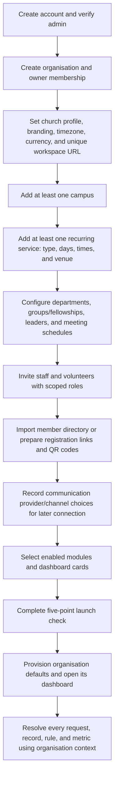
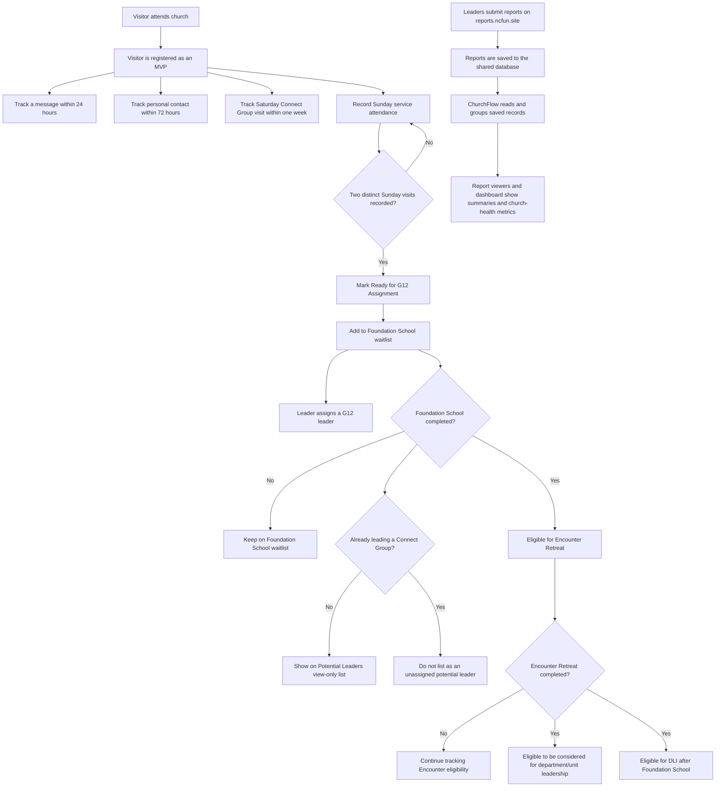
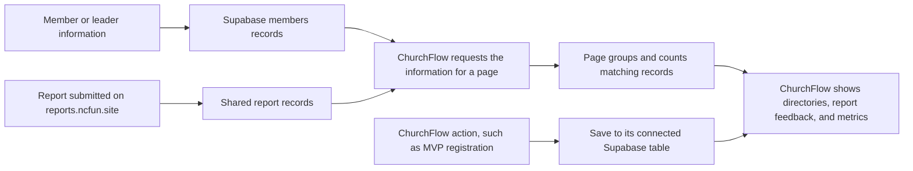
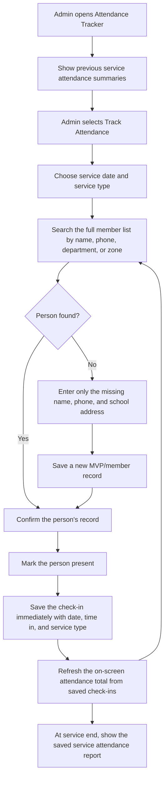
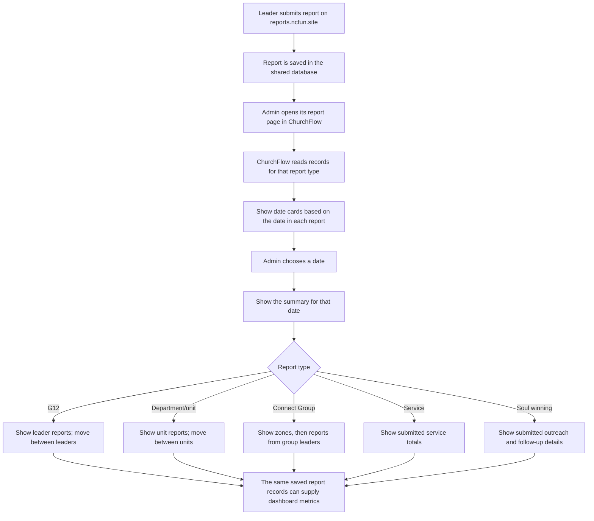

# ChurchFlow: Unified Church Membership and Discipleship Flow

ChurchFlow is a church membership and discipleship SaaS that helps leaders understand how their church is doing. It brings membership, attendance, reports, Connect Groups, G12, departments, outreach, and discipleship into one place so leaders can see reliable church-health measures and know where follow-up is needed.

This guide describes the intended workflow in plain language. It also identifies what the current app already does and what still needs to be connected. A number is a **live metric** only when it comes from saved, current records—not when it is typed into the page as an example.

## 0. SaaS setup comes before church operations

Organisation setup is the first part of ChurchFlow's algorithm, not a settings task to bolt on after the dashboard. No member, report, schedule, navigation item, or metric should be created or interpreted until ChurchFlow knows which organisation owns the data and which rules that organisation follows. Use **organisation** consistently as the product concept and `organisation_id` as the single canonical ownership key; do not introduce a second `tenant_id` or competing tenant/organisation root.



### Onboarding decisions and their effects

1. **Create account and organisation:** Verify the administrator, create the organisation, and create the creator's owner membership in a trusted, atomic server-side operation. Claim a unique organisation slug for its workspace URL (for example, `gracecity.appname.com`). Validate slug availability and provide a safe rename/redirect policy. Do not rely on browser-side inserts to establish ownership or authorization.
2. **Church profile and localisation:** Save the official church name, contact email, primary phone, logo, headquarters address, IANA timezone, base currency, and branding. Validate email, phone, timezone, currency, and image constraints. Use the organisation's timezone—not the user's device timezone—for local dates, schedules, reminders, and birthdays.
3. **Campuses and services:** Require at least one campus and one recurring service before launch. Each campus has a name and physical address. Each service/gathering has a name or configurable type, one or more meeting days, local start time (and end time when known), and meeting space/venue (including online when applicable). Allow additional campuses and service profiles after onboarding. Attendance and reminders must reference the correct campus and service rather than assuming one church-wide Sunday service.
4. **Church structure and schedules:** Configure departments/units, group and fellowship types, terminology, leaders, and meeting cadence. Structures may coexist: a church can use departments and small groups, and optionally add a G12 or other leadership hierarchy. Do not force one mutually exclusive topology or create fictitious assignments. For each configured group type, set its singular/plural labels, territory label if used, meeting days/times, and reporting windows. A church without small groups can disable that branch while retaining any other fellowship or department structures it uses. Store schedules per organisation and resource; do not infer that every group follows the same cadence.
5. **Staff and volunteer access (RBAC):** Start with role templates for **Owner**, **Assistant Pastor**, **Admin**, **Ushers**, and **Finance**, but let each organisation rename, create, combine, or remove non-owner roles and configure their privileges. Define permissions as explicit capabilities (view, create, edit, delete, approve, invite, manage settings, and export) with scopes such as whole organisation, campus, department, or assigned group. Offer safe suggested defaults, but require an authorised owner/admin to confirm them. The Owner retains organisation control; custom roles cannot grant platform-level access or exceed the assigning user's authority. Invite by email or phone with an expiry, acceptance flow, organisation scope, role, and any resource scope; support revocation and audit invitation/role changes. Apply permissions in the database/server and UI, not only by hiding navigation.
6. **Member directory initialization:** Provide a documented CSV template and preview/validation before records are committed (initial fields include full name, phone, email, gender, birth date, and marital status, with organisation-configured optional fields). Detect duplicates and let authorised staff resolve them; failed imports must not leave partial records. Support organisation-scoped self-registration links and printable QR codes for visitor slips, social media, or display. Links must be unguessable, revocable/rotatable, and allowlisted to intake fields; they do not grant access to existing records. Household grouping is optional; when used, store explicit relationships under a household ID and do not assume every person belongs to a family.
7. **Communications:** Let the organisation record intended channels and provider choices (for example SMS, transactional email, or WhatsApp) during setup, but defer credential entry, connection, and automated message activation to a later authorised configuration step. Show integrations as planned/not connected until verified. Do not send welcome, birthday, anniversary, or broadcast messages before a provider is connected, message templates are approved, and required consent/preferences are respected.
8. **Modules and dashboard:** Let the organisation select enabled modules and dashboard cards; validate dependencies and keep disabled modules unavailable in navigation, routes, APIs, reminders, and metrics. Finance may be enabled without connecting the financial Google Sheet or manually configuring categories during onboarding; those remain optional Finance-page setup.
9. **Five-point launch check:** Before opening the system to general members, verify and present the status of exactly these essentials: (a) meeting days/times and service schedules; (b) department/unit structure; (c) small-group/fellowship structure, or an explicit confirmation that it is not used; (d) member directory loaded or an intake route ready; and (e) staff/volunteer access and permissions reviewed. Block launch for unresolved required items, allow an authorised owner to save progress and resume, and do not claim readiness merely because optional modules were skipped.
10. **Provision and enter the dashboard:** Save organisation configuration, owner membership, confirmed roles, and required defaults; then mark onboarding complete only after the launch check passes. Provisioning must be safe to retry and must not duplicate seed records. If any step fails, surface the error and let the owner resume rather than showing a completed dashboard for a partially configured organisation.

### Organisation boundary and runtime algorithm

- Use one shared application schema with the canonical `organisation_id` on every organisation-owned record, including members, leaders, campuses, services, groups, reports, attendance, finance records, and settings. Do not create a separate physical database schema for every church just to change vocabulary. Keep configuration in typed, validated organisation fields and/or versioned organisation-settings records.
- Resolve the signed-in user's organisation membership and role on the server. Enforce organisation isolation in Postgres RLS and trusted write operations; client filters are not a security boundary. A user belonging to multiple organisations must select an active organisation, and every read/write must be scoped to its `organisation_id`.
- At startup, load the active organisation's configuration and use it as the source of truth for terminology, enabled modules, branding, timezone, currency, hierarchy, roles, campuses, services, and schedules. Sidebar visibility, route guards, data services, report expectations, and dashboard calculations must all use the same configuration.
- For each metric or workflow, first check that its module is enabled and the user's role grants access, then apply that organisation's structure and schedule to that organisation's saved records. If required configuration or source data is missing, show it as unavailable; do not silently fall back to NCF UNN values or sample data.
- Configuration changes must take effect consistently across pages and be auditable. Disabling a feature must not delete its data. Re-enabling it restores access to retained records subject to permissions.

The existing NCF UNN workflows below are the flagship organisation's baseline, not universal SaaS defaults. Their G12, Connect Group, Sunday/midweek, Saturday, follow-up windows, stage thresholds, and numerical targets must be represented as NCF UNN configuration. Another organisation's selected model, labels, enabled modules, and saved cadence take precedence. The organisation model and configuration provider are prerequisites for the organisation-scoped access and configuration architecture in the [ChurchFlow SaaS master plan](../CHURCHFLOW_SAAS_MASTER_PLAN.md); align its terminology and schema on `organisation_id` before implementing migrations.

## 1. The church journey after organisation onboarding



This is the NCF UNN baseline journey after organisation onboarding is complete. Resolve its labels, stages, schedules, and enabled branches from the active organisation configuration: skip G12 stages for an organisation without G12, skip group steps when small groups are disabled, and use configured meeting dates rather than assuming Saturday or Sunday. The 24/72-hour follow-up windows and two-visit threshold shown here are NCF UNN rules; other organisations must configure their own thresholds or leave them undefined rather than inherit them silently.

This flow has two connected parts:

1. **People pathway:** visitor → MVP follow-up → Sunday attendance → G12 and Foundation School → Encounter → leadership consideration and DLI.
2. **Church reporting:** leaders submit reports on **reports.ncfun.site** → the shared database stores them → ChurchFlow displays the reports and uses the saved information for metrics.

ChurchFlow should not invent missing facts. If a date, assignment, completion, or report is not recorded, show it as missing or unavailable instead of filling in an estimate.

## 2. How information moves through ChurchFlow

ChurchFlow is the screen leaders use. Supabase is the shared online database that holds the saved records.



The main records currently referenced by ChurchFlow are:

| Record group | What it is for |
| --- | --- |
| `members` | Main member list, including member name and available details such as phone, department, zone, G12 leader, membership level, and join date. |
| `mvps` | First-time visitor/MVP registration details. |
| `g12_reports` | G12 attendance submitted for individual members. |
| `department_reports` | Department/unit worker attendance submitted for individual workers. |
| `cell_reports` | Connect Group meeting information and totals. The current ChurchFlow type describes leader, location, meeting times, attendance, new converts, offering, refreshments, notes, and report date. |
| Service report records | Service attendance, MVP/second-timer numbers, souls won, offering, tithe, and related details, when supplied by the external report system. The exact table and saved column names must be confirmed against that system. |
| Soul-winning report records | Outreach and follow-up information, when supplied by the external report system. The exact table and saved column names must be confirmed before calculating totals. |
| Discipleship progress records | Sunday visits, G12 assignment, Foundation School, Encounter Retreat, DLI, and Connect Group leadership. The current ChurchFlow pages do not yet provide a confirmed saved record for this full pathway. |
| Connect Group directory and assignments | The real list of groups, their zones and leaders, and member assignments. These records are needed for trustworthy group totals and potential-leader checks; the current page uses examples instead. |

The external report site and ChurchFlow must use the same saved report information, or a reliable connection to it. ChurchFlow's report pages are **view-only**: submissions happen on reports.ncfun.site. The main Attendance Tracker is a separate service check-in workflow; it must save a check-in if it is to contribute to attendance history or a metric.

## 3. Membership dashboard and church-health metrics

When a leader opens the dashboard, ChurchFlow reads the member and report records needed for the selected metrics, calculates the totals, and displays the results. The dashboard is the church-wide overview; organizational pages provide the detail for departments, Connect Groups, and G12.

### Main KPI cards

| Dashboard measure | Information it should use |
| --- | --- |
| Registered members | Count of member records, with membership status clearly defined so inactive/alumni people are not silently confused with active members. |
| Active workers | Count of distinct members assigned to a department/unit, using the member roster rather than an attendance report alone. |
| Active Connect Groups | When groups are enabled, count groups whose reports meet the active-group rule in section 7, measured against the organisation's configured meeting cadence. |
| MVPs / first-time visitors | Track monthly MVPs from the mvp column in service reports. |
| Souls won | Count from confirmed saved soul-winning/service report records for the selected date range. Do not use Connect Group new-convert totals as a substitute unless the metric is explicitly defined that way. |
| Service attendance | Use saved service attendance records for the selected dates and service types. |
| Retention and follow-up | Use recorded MVP follow-up milestones and later attendance. Show the number who reach each step, not an invented retention percentage. |

Each time-based card must say which date range it covers. For example, “This week” must be calculated from this week's saved report dates, not from every row in the table.

### Dashboard charts and other displays

- Attendance trend: show total attendance from saved service reports over time. Provide 1 month, 3 months, 6 months, and 1 year filters, with optional filters for service type and zone where the source data supports them.
- Growth journey: count people at each saved membership/disciple stage; do not use sample counts.
- Department/unit health: calculate attendance from submitted unit reports and the assigned worker roster. Make clear whether the percentage is of people assigned or people included in submitted reports.
- Follow-up queue: show new MVPs due for follow-up and members whose saved attendance is declining. The rule for “declining” must be set from actual attendance history and shown consistently.
- Birthday notices: use member birthdays and the church's local date.
- Missing reports: compare expected reports with received reports. Only call a report missing after its scheduled reporting period has ended.
- Do not present the sample attendance chart, sample heatmap, hand-written ticker examples, or sample follow-up counts as live church metrics.

## 4. Service Attendance Tracker

The Attendance Tracker is where a desk admin records individual attendance at a service. It is not the same as the G12, department, or Connect Group feedback viewers.

### Intended check-in flow



The member search must cover the full database; it must not stop at the first 100 names. The desk admin/usher simply searches by name or phone and taps check-in—no unnecessary questions asked. Zone and department are auto-inherited from the member's record, and the exact **time in** is recorded automatically. If the member is not found, the admin enters only the minimum details (name, phone, school address) to register them as an MVP, saving and checking them in immediately.

Each saved check-in records the member, service date, service type, and exact time in. The same check-in must not be counted twice for one person at one service (enforced by the unique constraint). At the end of the service, the report is a summary of the check-ins already saved; it should not require the admin to submit the same attendance a second time.

## 5. Report pages: read submitted feedback

All G12, department/unit, Connect Group, service, and soul-winning reports are submitted through **reports.ncfun.site**. The corresponding ChurchFlow report pages are for **viewing the submitted feedback**, not entering or submitting it again.

### Shared report-viewing flow



The report date and report type come from the submitted record. ChurchFlow must not move a report to a different date because of when it was viewed. The date cards and expected reports must use the active organisation's configured meeting schedule. Wednesday/Sunday service, G12, and department/unit reports and Saturday Connect Group reports are the NCF UNN baseline only.

At the top of a selected report date, show the figures available from that report:

- **Present:** count of submitted person-by-person entries marked present.
- **Absent:** count of submitted person-by-person entries marked absent.
- **Total reported:** present plus absent when the report contains individual records; otherwise show the total attendance submitted in the meeting summary.
- **Total membership:** number assigned to the group/unit in the member records. Show separately from attendance, because unreported people must not disappear from the membership count.
- **Report coverage:** reports received compared with reports expected, if the expected leader/unit/group list is known. If it is unknown, show “reports received” and do not claim complete coverage.

### G12 report

After the admin selects a service date, show the overall G12 summary, including present, absent, total reported, total G12 membership, and report coverage where those figures are available. Then show a leader's name and the submitted attendance rows for that leader's members. Each row shows the member name, present/absent status, and absence reason if supplied. Use **Previous** and **Next** controls or a slide gesture to move between leaders while keeping the selected date visible.

### Department/unit report

After the admin selects a date on which the organisation schedules a department/unit report, show its summary. Then show one unit at a time with the submitted worker names, attendance status, and absence reasons where provided. Use **Previous** and **Next** controls or a slide gesture to move between units. The department directory page links here; it does not repeat this report. Wednesday and Sunday are the NCF UNN baseline.

### Connect Group report

Use this order: **configured meeting date → configured territory → group leader's report**. After the admin chooses a date, show the territories with submissions. Selecting a territory such as Odim, Eho, or Franco shows its group reports. Move between group leaders' reports within the chosen territory. Saturday and the example territory names are NCF UNN-specific.

The current report shape contains meeting-level details such as leader, location, times, total attendance, new converts, offering, refreshments, and notes. It may not include individual attendee names and statuses. Only display individual attendance if reports.ncfun.site actually saves those details.

### Service and soul-winning reports

Service reports should show saved information such as male/female/total attendance, MVPs, second-timers, souls won, offering, and tithe, but only for fields actually present in the submitted records.

Soul-winning reports should show submitted outreach records, dates, zones/campaigns, and follow-up details where available. Confirm the external source table and its fields before calculating or labelling a soul-winning metric.

### Missing report checks

Expected submissions are derived from each organisation's enabled modules, configured meeting days, reporting windows, and responsible leaders/units. For NCF UNN, the current baseline is:

- Wednesday and Sunday: service, G12, and department/unit reports.
- Saturday: Connect Group reports.

For each expected report, ChurchFlow needs the date, report type, responsible leader or unit, and (where relevant) territory. Mark a report missing only after that organisation's configured reporting window ends and no matching report is saved. The current NCF UNN windows are 7:00–9:00 PM for Wednesday/Sunday reports and 7:00–10:00 PM for Saturday Connect Group reports. A meeting not on the organisation's expected schedule should not be labelled missing.

## 6. Departments and Units: organizational view

This page is the church's organizational directory of departments and units. Keep the department/unit grid as the main view, with general KPI cards above it. Each card shows the unit name, leader, total people assigned, and new additions for the selected period. Selecting a card opens that unit's detail view with its own KPI cards, leader and assistant details, member roster, and organizational details.

Page-level KPI cards:

- **Total workers:** distinct members assigned to a department/unit.
- **New additions:** distinct people newly added to a unit during the selected date range.

Each unit card can also show that unit's total assigned people and additions. Use saved member assignments and a reliable join/assignment date. If the date needed to calculate additions is not saved, show the number as unavailable instead of guessing.

Provide a hamburger button in the department and unit views. Its menu includes **Job Description** and **View Reports**. **Job Description** opens the relevant description for the department or selected unit. **View Reports** opens the department report page (currently `/reports/department`), which owns service-date selection, attendance summaries, and worker-by-worker feedback.

**Flow:** Open Departments → see general KPI cards → browse unit cards → select a unit → see its KPI cards, leader and assistant details, and member roster → use the hamburger menu to open the job description or **View Reports** for submitted attendance feedback.

## 7. Connect Groups: organizational view

This page is the organizational view of Connect Groups, not a second attendance-report page. Keep the zone grid, then let admins open a zone and browse its actual Connect Groups. Selecting a group shows its leader, assigned members, and group size.

The NCF UNN planning target is **50 Connect Groups**, with a target size of **10–15 members per group**. These are organisation-specific targets, not SaaS defaults. Do not hide groups outside an organisation's configured target; show their size clearly so leaders can decide what action is needed.

Page KPI cards:

- **Total Connect Groups:** count of groups in the saved group directory, shown against the target of 50.
- **Active Connect Groups:** groups with a saved report for at least one of the two most recent scheduled group meetings.
- **Inactive Connect Groups:** groups with no saved report for two consecutive scheduled group meetings. Count missed scheduled meetings, not a fixed number of calendar days.
- **New additions:** distinct people newly added or assigned to a zone during the selected date range.
- **Potential Leaders:** people who completed Foundation School and are not currently leading a Connect Group. Clicking this card opens a **view-only list of names**; it does not appoint or assign them.

If a group has missed one scheduled report but not two, it is not yet inactive; it may be flagged for attention. Use actual submitted report dates and the organisation's schedule to determine activity.

Connect Groups data is **live and verified**. The page connects directly to the **40 real Connect Groups** in the `cell_leaders` table and the authoritative campus residential zones configured in Settings. Member distributions are dynamically populated from the active member records in Supabase, providing an authoritative organizational view of church cell structure.

Add a hamburger button to the header bar with **View Reports** and **Cell Outlines**. **View Reports** opens the Connect Group report page (currently `/reports/cell`) described in section 5. **Cell Outlines** opens the separate outline/resource archive, not reports.

**Flow:** When the module is enabled, open the organisation-configured group page → see the available total/active/inactive/additions/potential-leader KPI cards → browse territories → open a territory to see its groups and scoped KPIs → select a group to view its leader, assistant, members, and configured size target → click **Potential Leaders** to see eligible names → use the header menu to open **View Reports** for submitted reports or the configured resource archive.

## 8. G12 and Directorate Management: organizational view

This page shows leadership structures and member assignments; it is not the G12 attendance report page. Show KPI cards, then separate sections for **Directorate Heads (DHs)**, **Core Leaders**, and **G12 Leaders**. Keep the DH and Core sections distinct. Classify all pastors, DHs, and Core leaders as G12 leaders; the G12 section should reflect that classification while avoiding duplicate or conflicting underlying people and assignments. Selecting a leader opens the members assigned to that leader.

Page KPI cards:

- **Total G12 leaders:** count of leaders identified from saved leadership/assignment records.
- **Total Directorate Heads:** count of saved DHs, which are a subset of G12 leaders.
- **Total G12 members:** count of members assigned to a G12 leader.
- **New additions:** members newly assigned to a G12 leader during the selected date range.

Per-leader cards may show the leader's name, assigned-member count, and new additions. Use saved leader and assignment data. Identify pastors, DHs, and Core leaders as G12 leaders, while keeping DH and Core in their own separate sections. Keep recorded roles (pastor, G12 leader, Directorate head, Core leader, worker, unit leader) separate from attendance-based member classifications; do not infer one from the other.

Add a hamburger button beside the heading/action bar with **View Reports** and **Directorate Offices**. **View Reports** opens the G12 report page (currently `/reports/g12`) described in section 5. The directory shows structure and membership; the report page shows attendance feedback. **Directorate Offices** opens an office directory showing the core church systems, who oversees each system, an office description, and the units under that directorate. Use saved office, overseer, and unit assignments; do not infer the directorate structure from labels alone.

**Flow:** Open G12 and DH Management → see KPI cards and separate DH, Core, and G12 leader sections → select a leader → view assigned members → use the hamburger menu to open **View Reports** for submitted attendance or **Directorate Offices** to view core systems, their overseers, descriptions, and units under each directorate.

## 9. Foundation School: cohorts, attendance, and curriculum

Foundation School data must come from saved cohort, student, enrollment, class, teacher, curriculum, attendance, and completion records. Do not use sample data, manually entered totals, or Sunday service attendance as Foundation School data. Protect student records with role-based access and keep an audit trail for enrollment, attendance, completion, and any corrections.

### Cohorts and enrollment

- Show the current cohort, roster, assigned teachers, classes, schedule, and saved attendance summary. Previous cohorts remain available as historical records; starting a new batch must not move students, attendance, or completion records from earlier cohorts.
- Populate the waitlist from the member database with people who are not enrolled in the selected school. Include school filters for **Foundation School**, **Encounter**, and **DLI**. For Foundation School, authorized users may enroll selected waitlist members into a cohort. Waitlisted people remain unenrolled and are excluded from cohort attendance and completion totals until their enrollment is saved. Save enrollment date and status, and prevent duplicate active enrollment in the same school.
- Completion is tracked from saved course/cohort records only. Do not infer completion from waitlist status, partial attendance, or a curriculum listing. Use the saved completion record for downstream eligibility rules in sections 1 and 7.

### Cohort attendance tracker

- The admin selects a cohort, class/session, and session date, then records each enrolled student's status as present or absent. Save each entry against the student, cohort, class/session, and date so it remains available after refresh or later changes.
- For each class/session in a cohort, the admin selects the cohort, class/session, and session date, then records each enrolled student's status as present or absent and their time in. Save each entry against the student, cohort, class/session, and date so it remains available after refresh or later changes.
- Prevent duplicate entries for the same student and session. Allow only authorized corrections to saved entries, and keep a record of the correction reason and timestamp.
- Show present, absent, and not-yet-recorded counts separately. An unmarked student is not absent. Attendance summaries and student histories must use saved session entries only and must not change church service attendance.

### Curriculum and classes

- Show the curriculum for Foundation School courses and their lessons/topics. Link each class/session to its course, cohort, assigned teacher, and scheduled time when those details exist in saved records.
- A curriculum listing does not establish student progress or completion. That requires saved student progress/completion records.

### Foundation School reports

- The reporting site does not yet have a Foundation School submission form. Until the form and its saved report records exist, show report data as unavailable; do not create placeholder records or imply that ChurchFlow attendance entries are external submissions.
- If the external form is later added to reports.ncfun.site, leaders may submit the report there and ChurchFlow provides a view-only report page following section 5. The report must identify its date and cohort/class session and show: **Course | Teacher | Time in–Time out | Attendance**. Use saved submitted records only, and confirm the external table and column names before connecting a viewer or using the data in metrics. Attendance in a report must remain distinct from cohort enrollment and from church service attendance.

### Foundation School SOPs and regulations

- Add a dedicated **SOPs and Regulations** page within Foundation School. This is the operational reference for running the school, separate from cohort management, attendance tracking, curriculum, and reports. It is available only to authorized admins and teachers.
- Treat this content as a framework for the church's approved policies, not a substitute for them. Clearly label drafts as drafts; do not present examples or drafts as active regulations.
- Keep these SOPs distinct from external Foundation School report submissions and from the live enrollment/attendance workflow.
- Organize the page into:
  - **Roles and accountability:** specify who may approve cohorts and enrollments, assign teachers, schedule sessions, record or correct attendance, and verify completion. Enforce role-based permissions.
  - **Cohort setup and enrollment:** confirm the cohort, course, schedule, capacity, eligibility, and staff before enrollment opens. Record enrollment date and status. Keep waitlisted people separate until an authorized user enrolls them.
  - **Class and attendance procedure:** verify cohort, class/session, and date before recording attendance. Mark present or absent for each enrolled student; an unmarked entry remains not recorded. Prevent duplicate entries. Require corrections to include a reason and audit record.
  - **Conduct and participation:** show only the school's approved expectations for punctuality, respectful conduct, participation, absences, and make-up sessions. Do not invent sanctions or eligibility requirements.
  - **Assessment and completion:** document approved assessment and completion criteria, the responsible approver, and how results are saved. Attendance alone does not establish completion; completion requires saved student progress/completion records.
  - **Safeguarding and privacy:** limit student records to authorized roles, document the approved concern process, and preserve audit history for enrollment, attendance corrections, and completion changes. Do not expose sensitive student information on general-facing pages.
  - **Changes and exceptions:** identify who approves schedule changes, withdrawals, transfers, exceptions, and policy revisions, and what record is required. Preserve the decision and effective date.

## 10. Soul Winning and MVP retention

Coming soon. We'll get back to this page.

## 11. Finance: Giving, Donations & Expenses

ChurchFlow has one authorized **Finance** page, available when the organisation enables the finance module and the signed-in user has finance permission. It contains Giving & Donations, Expenses, and Reports/Imports as sections or tabs—not separate top-level pages. Access to member records does not automatically grant access to donor identities, bank details, expenses, finance reports, or exports. All records are scoped to the organisation and use its configured base currency.

The church's existing financial reports are maintained in a Google Sheet containing income and expense categories. Where authorized, ChurchFlow should read from that configured source rather than require the church to recreate categories during onboarding. If a church has no usable report source or prefers not to connect one, an authorized administrator may configure categories manually; this is optional setup, not an onboarding prerequisite.

Submitted offering/tithe summaries in service or Connect Group reports are not individual donor transactions and must not be added to donor totals as though they were.

### Reports and categories

- Configure the authorized Google Sheets source and the specific report/range or tabs used for income and expenses. Show its connection and last-refresh status; report stale or failed imports as errors, not as current financial totals.
- Use categories supplied by the financial report sheet where available. If the church opts to manage categories in ChurchFlow instead, let an authorized administrator define income and expense categories without blocking initial onboarding.
- Restrict viewing and editing of bank details to explicitly authorized finance roles; mask account details in general views and exports.
- Capture payment-gateway/provider selection as a later setup task, but mark online processing as **not connected** until an integration is completed and verified. Do not collect or store provider secrets in the browser or treat an unconnected gateway as available.
- Use the configured base currency for summaries. If multi-currency transactions are later supported, store the original currency and amount alongside the conversion details; do not silently combine unlike currencies.

### Expenses

- Expense reporting may be reviewed from the connected financial source. If ChurchFlow later supports directly submitted expense requests, keep requested, approved, rejected, and paid states distinct, record who acted and when, and include only verified paid expenses in actual-spend totals.
- Exclude donor identities and bank details from general member, department, and attendance exports.

### Giving & Donations

The Giving & Donations section imports or records account-statement and donor-contribution information, then organizes verified giving records into donor-name folders and categories such as **Tithe**, **Offering**, and **Other**. It supports donor-level histories while the Reports section can show church-wide income and expense categories from the connected Google Sheet.

Churches use different financial reports and manual documentation. Support the configured church's available source rather than assuming every source has one standard layout. Accept an authorized Google Sheets connection, CSV/Excel upload, PDF statement/document upload, and manual entry. Configure and label the source and its format; provide a preview and review step before imported records affect donor histories or totals.

### Import and reconciliation

- Parse statement/document rows into a reviewable draft with the source, transaction date, description/reference, amount, currency when present, and debit/credit or inflow/outflow where available. Preserve the original source reference and import batch for traceability.
- Support both donor-level contribution rows and pooled bank deposits. A pooled deposit is a church/account transaction, not proof of each donor's contribution. If donor breakdowns are in a separate sheet or document, allow finance staff to reconcile and allocate against that evidence; do not split or attribute a pooled amount automatically.
- Suggest a giving category (Tithe, Offering, or Other) from available source categories, names, and notes, but treat the suggestion as unconfirmed. Authorized finance staff can review or correct it before it contributes to categorized donor totals. Do not silently classify ambiguous records.
- Match a donor to an existing member/donor only when the match is sufficiently clear. Put uncertain or unmatched names in a finance-only resolution queue; do not create a member or donor profile automatically. Allow authorized staff to resolve the match or retain it as anonymous/unmatched.
- Detect likely duplicate imports and show them for review. Re-importing the same source must not silently double-count contributions. Preserve corrections, category changes, matching decisions, and allocations with actor, timestamp, and source history.
- Keep import, parsing, and reconciliation failures visible. PDF extraction or any inferred field is a draft requiring review, not a verified financial fact.

### Donor folders and individual giving history

- Provide permission-gated donor/name folders. Selecting a resolved person shows their dated giving records grouped by **Tithe**, **Offering**, and **Other**, with totals for a clearly selected date range and currency.
- Include only confirmed donor-level records in a person's individual history and totals. Show pending matches and unreconciled pooled deposits separately; never imply that an aggregate deposit belongs to a named donor without supporting allocation.
- Permit authorized staff to correct a record or donor match while preserving its original source information and audit history. Keep anonymous gifts available in aggregate totals without assigning them to a person.
- Restrict donor identities, giving histories, statement files, and exports to explicit finance permissions. Do not expose this information through the general members directory or ordinary member exports.
- If online giving is later enabled, ingest provider-confirmed transactions with their provider reference and settlement status. Do not treat a configured-but-unconnected gateway, pledge, or pending payment as received giving.

**Flow:** Finance user selects a source or enters a record → previews and validates rows → resolves categories and donor matches → reconciles pooled deposits against supporting donor documentation where available → confirms the import → authorized users browse donor folders or review aggregate giving by category and period.

### Finance reports and page behavior

- Show income and expense reports from the configured financial source with date-range and category filters, source/refresh status, and permission-gated exports. Clearly identify the source; incomplete or stale data must not be presented as a verified balance.
- Keep church-wide financial report totals separate from individual donor histories. Service and Connect Group reports may continue to show leader-submitted offering/tithe figures, but do not combine those summaries with imported giving transactions unless an authorized reconciliation explicitly links them.
- Keep finance exports permission-gated and auditable. If the finance module is disabled, remove its navigation and route access and suppress finance cards without deleting historical records.
- Online payment processing remains unavailable until a later provider integration is connected and verified.

**Page flow:** Open Finance → choose Giving & Donations, Expenses, or Reports/Imports → review or enter information permitted by the user's role → reconcile imported giving before it affects donor history or totals → filter and export authorized reports.

In the primary navigation, keep the existing navigation buttons together and place **About Us** immediately above **Settings**. Put **Settings** at the bottom of the navigation, visually separated from the other navigation buttons. The **About Us** button opens an About Us page containing the Dominion City experience chart, the ministry's twelve graces/anointings, and its core values. Present these as church information, not as member journey stages or calculated metrics.

## 13. What the current app does today

The intended flow above is the single target behavior. The following table records the current live implementations across all modules.

> **Clarification on "Live & Verified":** In this framework document, the status designation **"Live & Verified"** is an internal engineering indicator used during system audits. It confirms that a feature is connected to real, active PostgreSQL tables in Supabase with production data and passes build/TypeScript verification (as opposed to static prototypes or unmigrated schemas). In the actual user-facing application interface, no redundant technical audit badges are displayed—the application simply renders live data directly.

| Area | Current implementation | Status |
| --- | --- | --- |
| **Supabase Connection** | Shared client connected directly to production Supabase (`https://cjbedftdexzcsydwayig.supabase.co`). Verified tables: `members` (358), `dept_reports` (566), `g12_reports` (2,788), `service_reports` (64), `cell_leaders` (40), `department_leaders` (9), `cell_reports` (8), `service_attendance`. |  **Live & Verified** |
| **SaaS Organisation Onboarding** | No organisation signup/onboarding flow, organisation configuration provider, or organisation-scoped data model is wired into the current `src` application. Organisation isolation is not established in this frontend; the current deployment is the NCF UNN flagship, not yet an isolated multi-organisation SaaS. | **Not Implemented — Commercial SaaS Gate** |
| **Finance: Giving, Donations & Expenses** | Church financial reports and their income/expense categories are maintained in a Google Sheet. The current app does not have a Finance page, connected finance reports, expense workflow, statement/document import, donor folders, or individual tithe/offering histories. Service/Connect Group offering and tithe values are report summaries, not the church financial report or an auditable donor ledger. | **Not Implemented in ChurchFlow** |
| **Dashboard** | BentoGrid KPI cards, attendance growth curve, spiritual growth stages, and unit ministry health cards query live database summaries. Live ticker and announcements configurable in Settings. |  **Live & Verified** |
| **Attendance Tracker** | 1-tap live check-in engine; instantaneous live count updates; duplicate tap prevention via `UNIQUE(member_id, service_date, service_type)`. Auto-inherits `zone` and `department` from member records. Service history organized into expandable folders displaying attendee names and exact Time In (`checked_in_at`). |  **Live & Verified** |
| **Members Directory** | Interactive data grid featuring toggleable column visibility for all 15 question fields; includes newly added `Gender` column; search by name/phone/zone/unit; persistent column preferences; sequential row numbering (`#`); CSV export with Excel UTF-8 BOM; print directory. |  **Live & Verified** |
| **Universal Table Numbering** | Row numbering (`#`) implemented across all tables in the entire application (Attendance check-in, Service History rosters, Members directory, Department rosters, Connect Groups cells, Connect roster, G12 discipleship tree, and Settings). |  **Live & Verified** |
| **Universal Table Export Suite** | **100% table export coverage**: Every table across the entire OS (Dashboard recent members, Attendance live tracker, Service History session folders, Members directory, Department worker rosters, Departments summary, Connect Groups 40 cells, Connect cell member roster, G12 leaders, G12 discipleship tree, G12 service report logs, Department service report logs, Saturday Connect report logs, Campus Zones directory, and Settings admin operators) is equipped with instant Excel-compatible UTF-8 BOM CSV export and branded Print/PDF views. |  **Live & Verified** |
| **Departments and Units** | Fictional unit names purged. Canonical 9 units synchronized with Supabase `department_leaders` and Dashboard BentoGrid card. Live worker counts with smart alias matching for 566 `dept_reports` (`Admin` $\rightarrow$ `Administration`, `Ushers` $\rightarrow$ `Ushering`, etc.). Hamburger actions for Job Descriptions and View Reports. Fully editable in Settings. Export buttons on both all-units grid and individual worker rosters. |  **Live & Verified** |
| **Connect Groups & Campus Zones** | Connected to the **40 real Connect Groups** in `cell_leaders` dynamically grouped by campus residential zone (HQ: 19, Hilltop: 5, JSQ: 5, Franco: 3, Odenigwe: 3, Greenhouse: 3, Odim: 2). Live member distribution calculated from 358 member records. Dedicated Campus Zones Management architecture in Settings with authoritative Zonal Pastors. Export 40 Groups CSV and cell roster exports. |  **Live & Verified** |
| **G12 Management** | Live discipleship hierarchy loaded by leader name; discipleship rosters with row numbering (`#`); live capacity tracking (`X/12 Disciples · % Capacity`); export CSV and print for both G12 leaders and individual discipleship circles; links directly to G12 feedback reports. |  **Live & Verified** |
| **Settings & Admin Architecture** | Unified control panel managing BentoGrid KPI cards, live ticker, department units (name, head, phone, target), connect groups (40 cells), campus zones (names, zonal pastors, coverage areas), and G12 shepherds. Live propagation across all pages via custom event broadcasts. Export buttons on all tables. |  **Live & Verified** |
| **Report Pages** | **Executive View-Only**: Queries live feedback from `dept_reports`, `g12_reports`, and `cell_reports` submitted externally via `reports.ncfun.site`. Inspects feedback by meeting date, territory, unit, and leader. Equipped with Excel-compatible UTF-8 BOM CSV exports and print views. Direct link to external submission portal (`reports.ncfun.site`). Zero internal duplicate forms. |  **Live & Verified** |
| **Foundation School** | Honest unavailable states maintained pending remote database migration (cohorts/curriculum tables are not yet deployed in remote DB). | ⚪ **Pending Remote DB Migration** |
| **Soul Winning & Outreach** | MVP registration saves directly to `mvps` and `members` with duplicate checks; outreach campaigns and intake roster equipped with sequential row numbering (`#`), CSV export, and print roster. |  **Live & Verified** |

---

## 14. Phased Implementation Roadmap & SaaS Gate

The project follows a dependency-first roadmap. The NCF UNN operational phases below are already complete, but they did not establish organisation isolation. The SaaS foundation is a prerequisite to onboarding another church or marketing the platform as multi-organisation; its placement first is intentional even though the flagship implementation work preceded it.

```mermaid
flowchart LR
    P0[Phase 0: SaaS Organisation Foundation & Onboarding] --> P1[Phase 1: Database & Remote Schema Verification]
    P1 --> P2[Phase 2: Executive Dashboard Live Metrics]
    P2 --> P3[Phase 3: Persistent Attendance Tracker Engine]
    P3 --> P4[Phase 4: Canonical Leadership & Department Architecture]
    P4 --> P5[Phase 5: Connect Groups & Campus Zones Live Sync]
    P5 --> P6[Phase 6: Discipleship Journey & Milestone Engine (Deferred)]
```

### Phase Breakdown

0. **Phase 0 — SaaS Organisation Foundation & Onboarding:** **NOT IMPLEMENTED — required before another church can safely onboard.**
   - Define the canonical organisation record and membership/role model using `organisation_id` as the only organisation ownership key. Reconcile legacy naming before migrations; do not create parallel `tenant_id` and `organisation_id` identifiers.
   - Create resumable, validated onboarding for account/organisation creation, profile/localisation, workspace slug, campuses and services, coexisting church structures and schedules, flexible RBAC, member intake, and deferred communication integrations.
   - Add `organisation_id` ownership to every organisation-owned record and enforce isolation with Postgres RLS and trusted write operations. Migrate existing NCF UNN records into one explicit organisation and verify they remain visible only to that organisation.
   - Implement a typed organisation configuration loader and make route guards, sidebar entries, service/report expectations, labels, roles, and dashboard metrics use that same configuration. Treat current NCF UNN values as its configuration, not shared defaults.
   - Implement secure organisation-scoped invitations, intake links and QR codes, and validated CSV import; test permission scopes, expiry/revocation, retries, duplicate handling, and partial failures.
   - Test cross-organisation read/write denial, role permissions, onboarding recovery, disabled-module behavior, and configured timezone/service schedule behavior in staging before enabling new organisation signups.

1. **Phase 1 — Shared Database & RPC Schema Verification:** [COMPLETED 17 October 2026]
   - Verified live Supabase tables, endpoints, constraints, and data volumes (`members`: 358, `dept_reports`: 566, `g12_reports`: 2,788, `service_reports`: 64, `cell_leaders`: 40, `department_leaders`: 9, `service_attendance`: persistent).
   - Resolved authoritative table name discrepancy (`dept_reports` instead of 404 `department_reports`).
   - Confirmed direct PostgREST table querying (no remote RPC functions).

2. **Phase 2 — Executive Dashboard Live Metrics:** [COMPLETED 17 October 2026]
   - Mapped BentoGrid KPI cards, spiritual growth stages, and attendance growth curves directly to verified database records.
   - Removed synthetic data generators; linked heatmap to real recorded service dates.

3. **Phase 3 — Persistent Attendance Tracker Engine & Table Architecture:** [COMPLETED 18 October 2026]
   - Built 1-tap frictionless check-in with instantaneous live count updating.
   - Auto-inherited `zone` and `department` from member profiles in background.
   - Enforced duplicate prevention via `UNIQUE(member_id, service_date, service_type)`.
   - Built Service History folders displaying attendee names and exact Time In (`checked_in_at`).
   - Implemented toggleable column visibility for all 15 question fields in Members directory, added `Gender` column.
   - Enforced universal row numbering (`#`) across every table in the platform.

4. **Phase 4 — Canonical Leadership & Department Architecture:** [COMPLETED 19 October 2026]
   - Removed all mock/fictional unit names and leaders (*Sanctuary Praise, Decoration Unit, David Okonkwo*, etc.).
   - Locked system to the canonical 9 departments and assigned heads from Supabase `department_leaders` and BentoGrid Directorate Health:
     1. **Administration** — Emmanuella Okonkwo
     2. **Ushering** — Kosisochukwu Mbamalu
     3. **MVP** — Janefrancis Igwilo
     4. **NCF Angels** — Kosisochukwu Onyibor
     5. **Temple tenders** — Ifeyinwa Umeadi
     6. **Technical Unit** — Udochukwu Aneke
     7. **Finances** — Faithfulness Onu
     8. **Media Unit** — Nelson Okeke
     9. **Intercessory** — Godreigns Anyachebelu
   - Enabled full live editing in Settings (`SettingsAdminPage.tsx`), syncing changes to Supabase and broadcasting `churchflow_leadership_updated` across G12, Departments, Members, Reports, and Dashboard.
   - Implemented alias normalization for 566 `dept_reports` (`Admin` $\rightarrow$ `Administration`, `Ushers` $\rightarrow$ `Ushering`, etc.).

5. **Phase 5 — Connect Groups & Campus Zones Live Sync:** [COMPLETED 19 October 2026]
   - Connected [`ConnectGroupsPage.tsx`](file:///c:/Users/USER/Desktop/ATTENDANCE%20TRACKER/churchflow/src/features/connect/ConnectGroupsPage.tsx) directly to the **40 real Connect Groups** in `cell_leaders`.
   - Added dedicated **Campus Zones Management** architecture in Settings (`SettingsAdminPage.tsx` under Leadership Architecture tab):
     - **HQ Zone:** Pastor Tony Ubagu *(Fellowship Center / Freedom Square)*
     - **Franco Zone:** Pastor Kene Offiah *(Franco Hostel Cluster / Mary Slessor)*
     - **Hilltop Zone:** Pastor Royal Iroh *(Hilltop Enclave / Behind Flat)*
     - **Odenigwe Zone:** Pastor Promise Okeke *(Odenigwe Road & Environs)*
     - **Odim Zone:** Pastor Francis Ogbozor *(Odim Gate & Staff Quarters)*
     - **JSQ Zone:** Winner Richards *(Junior Staff Quarters / Vet Mountain)*
     - **Greenhouse Zone:** Kene Offiah *(Greenhouse Lodge & Environs)*
     - **Campus Hostels:** Mmesoma Ozor *(Bello, Alvan, Eni Njoku, Okpara)*
     - **Ede-Oballa:** Noble Onwuka *(Township / Off-Campus Extension)*
   - Dynamic real member counts per zone queried live from the 358 member records in Supabase.
   - Universal row numbering (`#`) across all Connect Groups and G12 discipleship rosters.
   - Universal Table Export Suite (Excel UTF-8 BOM CSV & Print across 100% of tables).

6. **Phase 6 — Discipleship Journey & Milestone Progression Engine:** [DEFERRED — TO BE BUILT IN FUTURE PHASE]
   - *Scope Note:* Universal table exports and G12 circle rosters were delivered under the Universal Export Suite in Phase 5.
   - The automated tracking of discipleship milestones (MVP intake $\rightarrow$ 2 Sunday visits $\rightarrow$ Foundation School cohort enrollment $\rightarrow$ Encounter Retreat completion $\rightarrow$ DLI and leadership appointment) is deferred to be built in a subsequent phase.

---

**Current Gate:** **NCF UNN operational Phases 1 through 5 are live and verified; Phase 6 (Discipleship Milestone Progression) is deferred for future build; Phase 0 (SaaS Multi-Tenant Isolation) remains open before commercial onboarding.**

---

## 15. Production Readiness, Security & Data Governance

To ensure ChurchFlow is publish-ready for deployment to production on `ncfunn.site`, the following security, authentication, and data governance controls are implemented:

### 1. Authentication & Route Protection
- **Executive Access Portal (`/login`):** Cyber navy authentication screen handling email/password sign-in and operator account creation via Supabase Auth.
- **Route Guarding (`ProtectedRoute.tsx`):** All administrative and operational routes (`/`, `/attendance`, `/members`, `/connect`, `/departments`, `/g12`, `/reports/*`, `/settings`) require active authenticated sessions.
- **Public Entry Points:** Only `/login`, public visitor intake `/mvp`, and member self-update links (`/u/:token`, `/update/:token`) are exposed to unauthenticated users.
- **Session Management:** Reactive session listener in `AuthContext.tsx` handles automatic token refresh, loading pulse transitions, and role-aware sign-out.

### 2. Database Hardening & Row Level Security (RLS)
The production migration script `supabase_rls_and_settings.sql` enforces:
- **Restricted Anonymous Access:** Public unauthenticated visitors can ONLY submit intake forms to the `mvps` table and read church branding from `church_settings`.
- **Protected Member Records:** Full access to `members`, `service_attendance`, `dept_reports`, `g12_reports`, `service_reports`, `cell_leaders`, and `department_leaders` is restricted strictly to authenticated operators.
- **Auto-Syncing Admin Profiles:** An auth trigger on `auth.users` automatically provisions records in `admin_profiles` upon staff account creation.

### 3. Settings & Cloud Persistence with Local Fallback
- **Dual-Layer Persistence:** `settingsService.ts` synchronizes church branding, BentoGrid KPI configurations, and authorized operator lists with the Supabase `church_settings` and `admin_profiles` tables.
- **Zero-Downtime Fallback:** Reads and writes utilize a local storage cache first, ensuring continuous operation even during database migrations or intermittent connectivity.

### 4. Data Protection & Privacy (NDPA Compliance)
- **Member Consent:** First-timer intake explicitly captures data processing consent for church pastoral care and updates.
- **Export Governance:** CSV and Print exports containing full member contact details (phones and emails) are restricted to authenticated secretariat and executive personnel.
- **Sensitive Data Masking:** Publicly accessible intake and self-update views mask personal identifiers to prevent unauthorized scraping.

### 5. Automated Backups & Disaster Recovery
- **Daily Automated Backups:** PostgreSQL backups run daily via Supabase automated backup schedules.
- **Universal CSV Snapshot:** The Universal Table Export Suite allows authorized officers to take an instant, comprehensive offline Excel-compatible snapshot of all church records (Members, Service Check-ins, Department rosters, and Connect Groups) with a single click.
